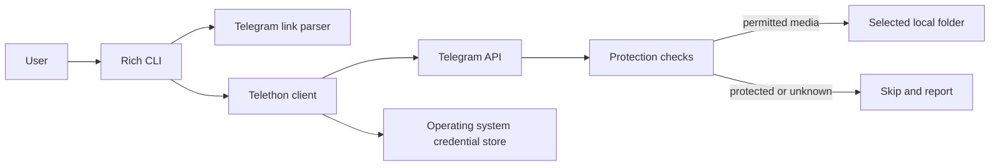

# Architecture

## Context

`telegram-dumper` is a local terminal client. It authenticates directly to Telegram as the user's
account, reads chats already available to that account, and saves selected attachments to a local
folder. It has no service backend and sends no media to a third party.

## Data flow

## Components

| Component | Responsibility |
| --- | --- |
| `cli.py` | Command parsing and guided terminal flow |
| `source.py` | Parse public links and private message links without joining invite links |
| `protection.py` | Reject chat and message content marked as protected |
| `telegram_client.py` | Authenticate, scan permitted messages, filter and save media |

## Invariants

- Protected content is never downloaded. If private-chat protection cannot be checked, the operation
  stops rather than assuming permission.
- The account must already have access to the chat. The program does not join invite links.
- Original media is saved without format conversion.
- Telegram authorisation data stays in the operating system credential store and never enters Git.
- Downloads stay local to the user-selected output directory.

## Failure and recovery

The first implementation skips existing filenames and reports protected messages. Interrupting a
download may leave a partial file; inspect and remove it manually before retrying. No history is
deleted and the tool does not change chat settings.
